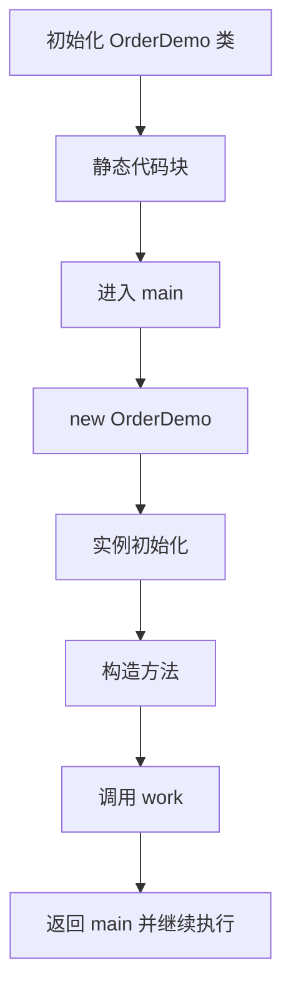

# 第13章 Java 程序运行原理、包与打包

> 本章目标：看懂 Java 源码从编译到运行的过程，理解程序入口和常见执行顺序，能使用 `package` 与 `import` 组织类，并区分 JAR 和 WAR。

第 2 章已经运行过最小 Java 程序。本章把当时的“运行”展开，说明 Java 程序如何找到类、从哪里开始执行，以及编译后的文件如何打包。

## 一、从源码到运行


- `.java` 是开发者编写的源文件；`javac` 检查语法并编译成 `.class` 字节码。**编译成功不代表程序已经执行。**
- `java` 命令启动 JVM。JVM 按需加载类、执行字节码；运行期间还会管理内存等资源。这里的流程图是便于理解的概览，不表示 JVM 内部只有这些步骤。
- `main` 是普通 Java 应用常见的入口方法。运行时先进入 `main`，然后按代码中的方法调用继续执行；运行到 `main` 末尾不一定立刻结束，其他仍在运行的线程也会影响进程退出。

下面是一个可以直接编译和运行的最小例子。文件名为 `Main.java`：

```java
public class Main {
    public static void main(String[] args) {
        System.out.println("Hello, Java!");
    }
}
```

在文件所在目录执行：

```bash
javac Main.java
java Main
```

第一条命令生成 `Main.class`，第二条命令运行类 `Main`。这里写类名，不写 `Main.class`。控制台输出 `Hello, Java!`。

## 二、程序中的执行顺序

先看一段代码，预测输出顺序，再对照结果：

```java
public class OrderDemo {
    static {
        System.out.println("1. 静态代码块");
    }

    {
        System.out.println("3. 实例代码块");
    }

    public OrderDemo() {
        System.out.println("4. 构造方法");
    }

    public void work() {
        System.out.println("5. 普通方法");
    }

    public static void main(String[] args) {
        System.out.println("2. main 开始");
        OrderDemo demo = new OrderDemo();
        demo.work();
        System.out.println("6. main 结束");
    }
}
```

运行 `javac OrderDemo.java`、`java OrderDemo`，会按标号 1～6 输出。这里的先后关系是：

1. JVM 初始化 `OrderDemo` 类时，先执行静态初始化（静态字段初始化和静态代码块按源码顺序执行）。这个例子中，它先于 `main`。
2. 进入 `main`，从上到下执行语句。
3. 遇到 `new OrderDemo()` 时，初始化新对象：先执行实例字段初始化和实例代码块，再执行构造方法；同一类中的这些初始化动作也按源码顺序进行。
4. `demo.work()` 调用普通方法，方法执行完返回调用处，随后继续执行 `main` 中剩余的语句。



这个顺序以**本例没有继承、只创建一次对象、没有额外线程**为前提。创建第二个 `OrderDemo` 时，静态代码块不会再执行，但新对象的实例初始化和构造方法会再执行一次。涉及继承时，父类的相关初始化还会先于子类。

## 三、包与 import

`package` 给类指定命名空间。不同包可以存在同名类，例如 `sales.Employee` 和 `hr.Employee`。`import` 让代码可以使用其他包中的类的短名称；它不会复制类，也不会改变程序的执行顺序。

包名通常使用小写字母，并采用域名反写加功能名称的形式，例如 `com.example.sales`。源文件应放在与包名对应的目录中，编译输出也会形成相应目录。

假设项目有以下文件：

```text
src/
└── com/example/
    ├── sales/Employee.java
    └── app/Main.java
```

`src/com/example/sales/Employee.java`：

```java
package com.example.sales;

public class Employee {
    public String getName() {
        return "Tanaka";
    }
}
```

`src/com/example/app/Main.java`：

```java
package com.example.app;

import com.example.sales.Employee;

public class Main {
    public static void main(String[] args) {
        Employee employee = new Employee();
        System.out.println(employee.getName()); // 输出：Tanaka
    }
}
```

在包含 `src` 的目录中编译并运行：

```bash
javac -d out src/com/example/sales/Employee.java src/com/example/app/Main.java
java -cp out com.example.app.Main
```

`-d out` 指定 `.class` 文件的输出目录；`-cp out` 告诉 JVM 去哪里找类。运行时使用**完整类名** `com.example.app.Main`。如果两个包里都有 `Employee`，可以在代码中用完整类名明确指定，例如 `com.example.sales.Employee`，避免短名称冲突。

包还能配合 `public`、默认访问权限等限制类和成员的可见范围。访问限定符的详细用法见第 8～12 章。

## 四、JAR 文件

JAR（Java Archive）用于把编译后的 `.class` 文件和资源文件合在一个压缩包中，便于分发。**JAR 是文件格式；只有包含合适入口和运行所需依赖时，才能直接用 `java -jar` 启动。**

沿用上一节已经生成的 `out` 目录，在项目根目录创建 `manifest.txt`：

```text
Main-Class: com.example.app.Main
```

清单文件这一行末尾需要换行。接着执行：

```bash
jar cfm learning-demo.jar manifest.txt -C out .
java -jar learning-demo.jar
```

- `c` 创建归档，`f` 指定 JAR 文件名，`m` 读取自定义清单；`-C out .` 把 `out` 中的内容按原有包目录放进 JAR。
- `Main-Class` 指定入口类的完整类名，不能写 `.java` 或 `.class` 后缀。
- 运行本例会输出 `Tanaka`。本例只使用 JDK 自带类；如果项目还依赖外部库，打包和运行时还需处理这些依赖。第 20 章将介绍 Maven 构建工具。

如果只是把类和资源归档为供其他程序使用的库，可以创建没有 `Main-Class` 的 JAR；这种 JAR 不能直接用 `java -jar` 作为应用启动。

## 五、WAR 是什么，怎样打包

WAR（Web Application Archive）是 **Java Web 应用的部署包**。它把网页文件、编译后的类和应用依赖等按 Web 应用的目录约定放在一起，方便交给 Tomcat 等 Servlet 容器部署。部署后，由容器接收 HTTP 请求并调用应用代码；这与上一节从 `main` 启动的普通 Java 示例是不同的使用场景。

一个传统 Web 项目打包后的常见结构如下：

```text
example.war
├── index.jsp
└── WEB-INF/
    ├── classes/    # 编译后的类和资源
    └── lib/        # 应用依赖的 JAR
```

`WEB-INF` 是 Web 应用的内部目录。传统项目也可能有 `WEB-INF/web.xml`，但不是每个项目都必须编写这个文件。

**怎样打包：**在一个已经配置好 Web 功能和依赖的 Maven 项目中，把 `pom.xml` 的打包类型设为 `war`：

```xml
<groupId>com.example</groupId>
<artifactId>employee-web</artifactId>
<version>1.0</version>
<packaging>war</packaging>
```

在项目根目录（`pom.xml` 所在目录）执行：

```bash
mvn package
```

Maven 会调用 WAR 打包插件，通常在 `target/` 下生成 `employee-web-1.0.war`。传统 Web 项目的网页文件通常放在 `src/main/webapp/`。生成 WAR 后，还需要将它部署到与项目兼容的 Servlet 容器中；**仅把普通 Java 类改成 `<packaging>war</packaging>`，不会自动变成可处理 HTTP 请求的 Web 应用**。Maven 的完整项目配置将在第 20 章介绍。打包方式可参见 [Apache Maven WAR Plugin 官方说明](https://maven.apache.org/plugins/maven-war-plugin/usage.html)。

## 六、JAR 和 WAR 的区别

| 对比 | JAR | WAR |
| --- | --- | --- |
| 全称 | Java Archive | Web Application Archive |
| 常见用途 | Java 类库、命令行程序、可执行应用 | 传统 Java Web 应用部署包 |
| 典型内容 | 类文件、资源文件、清单等 | Web 应用文件及 `WEB-INF` 下的类与依赖等 |
| 常见运行方式 | 有入口的应用可用 `java -jar` 启动 | 通常部署到 Tomcat 等 Servlet 容器 |

两者都属于归档文件，但用途和组织方式不同。学习普通 Java 程序时，先掌握 JAR 即可。后续接触 Java Web 或 Spring Boot 项目时，再根据项目的部署方式决定打成 JAR 还是 WAR。Spring Boot 也可以使用可执行 WAR，因此“WAR 一定不能直接运行”并不准确。

## 本章总结

- Java 源码先编译成字节码，再由 JVM 加载并执行；普通应用通常从 `main` 方法开始。
- 本章示例的顺序是类初始化、进入 `main`、创建对象、执行实例初始化与构造方法、调用普通方法。
- `package` 用于组织类和避免名称冲突，`import` 方便使用其他包中的类。
- JAR 适合类库和 Java 应用；WAR 常用于部署 Java Web 应用。
