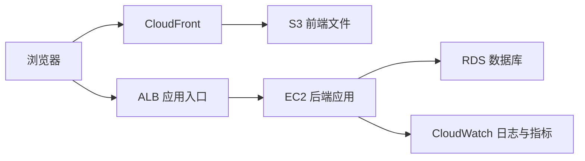

# AWS 基础与架构教程

本课程从部署基础、账号权限开始，依次认识计算、存储、网络、数据库、监控与 Serverless。建议先学会 [Linux 基础命令](../../tools/linux/index.md)、[HTTP 基础](../../web_basics/01_http_rest_cookie_cors.md)，并了解 [Spring Boot](../../backend/springboot/index.md) 的本地运行方式。

下图是本课程逐步认识的典型 Web 系统，箭头表示请求或数据流，并非浏览器会实际创建这些 AWS 资源。

## 学习顺序

1. [预备知识：云计算与部署](00_prerequisites.md)
2. [IAM：账号与权限](01_iam_fundamentals.md)
3. [EC2 与 SSH](02_ec2_ssh.md)
4. [S3 对象存储](03_s3_storage.md)
5. [CloudFront 与 CDN](04_cloudfront_cdn.md)
6. [RDS 关系型数据库](05_rds.md)
7. [VPC 网络](06_vpc_network.md)
8. [ALB 与自动扩缩容](07_alb_auto_scaling.md)
9. [CloudWatch 监控](08_cloudwatch_monitoring.md)
10. [HTTPS 与 ACM](09_https_acm.md)
11. [CloudWatch 日志与排查](10_cloudwatch_logs.md)
12. [Lambda 与 Serverless](11_lambda_serverless.md)
13. [Serverless 综合练习](../../exercises/cloud/aws/12_serverless_practice.md)
14. [EC2 与 Serverless 架构对比](13_architecture_comparison.md)
15. [常用 AWS 服务总览](14_common_services_overview.md)

## 实操前先确认

本网站只展示教材，不连接 AWS 账号，也不会创建云资源。控制台菜单、免费计划和价格可能变化；创建资源前，请在自己的账号中核对资格、区域、预算与预计费用，并按练习要求清理资源。[AWS 免费计划说明](https://aws.amazon.com/free/free-tier-faqs/)与 [EC2 免费计划使用说明](https://docs.aws.amazon.com/AWSEC2/latest/UserGuide/ec2-free-tier-usage.html)可用于核对当前规则。不要把访问密钥、私钥或真实业务数据写入练习。
