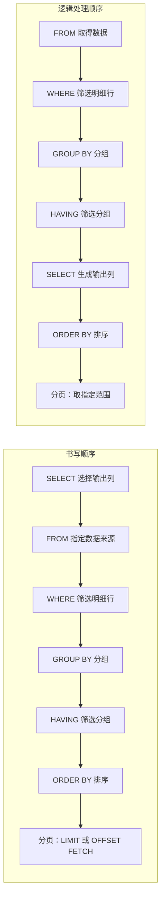

# 第9章 SELECT 基础查询

> 本章目标：掌握 `SELECT` 基础查询、字段选择、别名、条件、排序和分页，能够读取表中的目标数据。

## 一、SELECT 是什么

`SELECT` 用于从表中查询数据。

基本语法：

```sql
SELECT 列1, 列2
FROM 表名
WHERE 条件
ORDER BY 排序列;
```

SQL 的书写顺序与逻辑处理顺序不同。下面的两列分别从上往下看：



没有使用的子句可以跳过。例如本章的基础查询没有 `GROUP BY` 和 `HAVING`；这两项会在[第 11 章分组与聚合函数](11_groupby_aggregate.md)中学习。分页语法依数据库而异，见本章第六节。图表示帮助理解查询结果的逻辑顺序，不代表数据库实际逐步执行的物理计划；复杂查询还可能涉及去重、窗口函数或集合操作。

## 二、查询指定字段

```sql
SELECT id, name, email
FROM employees;
```

结果：

| id | name | email |
| --- | --- | --- |
| 1 | Tanaka | tanaka@example.com |
| 2 | Suzuki | suzuki@example.com |

不建议在正式查询中长期使用：

```sql
SELECT *
FROM employees;
```

`SELECT *` 会查询全部字段，字段变多后不利于性能和维护。

## 三、别名

列别名：

```sql
SELECT name AS employee_name,
       salary AS monthly_salary
FROM employees;
```

表别名：

```sql
SELECT e.id, e.name
FROM employees e;
```

Oracle、PostgreSQL、SQL Server、MySQL 都支持列别名和表别名。

## 四、WHERE 条件

```sql
SELECT id, name, salary
FROM employees
WHERE salary >= 300000;
```

结果：

| id | name | salary |
| --- | --- | --- |
| 1 | Tanaka | 300000 |
| 2 | Suzuki | 320000 |

常用条件：

| 条件 | 作用 |
| --- | --- |
| `=` | 等于 |
| `<>` | 不等于 |
| `>`、`>=`、`<`、`<=` | 比较大小 |
| `BETWEEN ... AND ...` | 范围 |
| `IN (...)` | 多个候选值 |
| `LIKE` | 模糊查询 |
| `IS NULL/IS NOT NULL` | 判断空值/非空值 |

## 五、排序

```sql
SELECT id, name, salary
FROM employees
ORDER BY salary DESC;
```

| 写法 | 说明 |
| --- | --- |
| `ASC` | 升序，默认 |
| `DESC` | 降序 |

## 六、分页

分页用于每次只查询一部分数据。

| 数据库 | 写法 |
| --- | --- |
| MySQL | `LIMIT 10 OFFSET 0` |
| PostgreSQL | `LIMIT 10 OFFSET 0` |
| Oracle 12c+ | `OFFSET 0 ROWS FETCH NEXT 10 ROWS ONLY` |
| SQL Server 2012+ | `OFFSET 0 ROWS FETCH NEXT 10 ROWS ONLY` |

MySQL / PostgreSQL：

```sql
SELECT id, name
FROM employees
ORDER BY id
LIMIT 10 OFFSET 0;
```

Oracle / SQL Server：

```sql
SELECT id, name
FROM employees
ORDER BY id
OFFSET 0 ROWS FETCH NEXT 10 ROWS ONLY;
```

SQL Server 使用 `OFFSET FETCH` 时必须有 `ORDER BY`。

## 七、常见错误

| 错误 | 原因 | 修正 |
| --- | --- | --- |
| 查询结果顺序不固定 | 没有写 `ORDER BY` | 需要固定顺序时必须排序 |
| `NULL` 用 `= NULL` 判断 | SQL 中 `NULL` 不能这样比较 | 使用 `IS NULL` |
| 分页没有排序 | 每页结果可能不稳定 | 分页查询加 `ORDER BY` |

## 八、本章练习

请完成：

1. 查询员工 ID、姓名、邮箱。
2. 查询工资大于等于 300000 的员工。
3. 按工资从高到低排序。
4. 分别写出四种数据库的第一页分页查询。

## 九、本章总结

- `SELECT` 用于查询数据。
- 正式查询建议指定字段。
- `WHERE` 用于筛选行。
- `ORDER BY` 用于排序。
- 分页语法在四种数据库中有差异。
