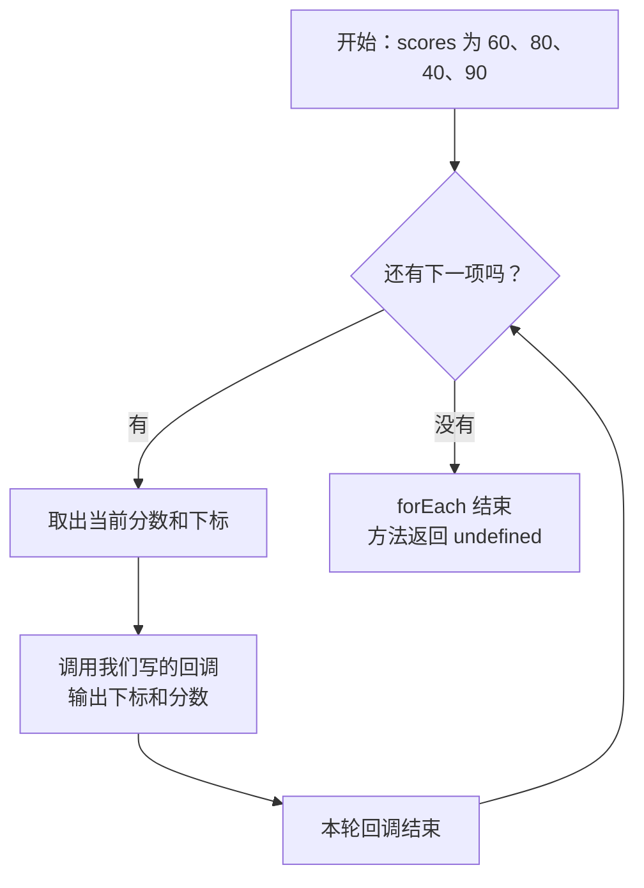

# 第 8 章 数组回调方法

## 学习目标

完成本章后，你应能够：

- 说明回调函数的当前元素、下标和原数组参数。
- 根据处理、查找、筛选、转换、判断、排序和汇总需求选择方法。
- 区分返回单个值与新数组的方法。
- 使用数字和字符串数组验证结果。

本章每个完整代码块独立运行，不需要接着执行上一例。标注为“语法”的代码只用于阅读结构。

## 1. 数组有哪些回调方法

第 7 章已经学过回调函数：**把函数作为参数交给另一段代码，由接收方在适当时机调用。** 在数组中，`forEach()`、`filter()`、`map()` 等方法会接收这样的函数。第 5 章的 `includes(80)` 只能直接寻找一个确定的值；若要表达“每项都输出”“找出符合条件的项”或“把每项变成另一种值”，就把**处理规则写成回调函数**，交给数组方法。数组方法负责依次取值、调用回调；回调负责处理当前这一项。

本章先用最容易观察的 `forEach()` 理解调用过程，再学习其他方法。先看用途，不必立刻记住全部细节：

| 想做什么 | 方法 | 方法返回什么 | 是否会提前停止 |
| --- | --- | --- | --- |
| 对每项执行操作 | `forEach()` | `undefined` | 不会按回调返回值停止 |
| 找到第一项或位置 | `find()`、`findIndex()` | 元素或下标 | 找到后停止 |
| 留下符合条件的项 | `filter()` | 新数组 | 通常处理完全部项 |
| 把每项转换成新值 | `map()` | 新数组 | 通常处理完全部项 |
| 判断有没有或是否全部符合 | `some()`、`every()` | 布尔值 | 结果确定时停止 |
| 排序或累计 | `sort()`、`reduce()` | 原数组或累计结果 | 规则与前面的方法不同 |

`sort()` 的回调接收两个待比较元素，`reduce()` 的回调先接收累计值；不能把它们的参数直接套用到 `forEach()` 上。下面先从一次只处理一个元素的 `forEach()` 开始。

## 2. forEach()：先看一次完整执行

`forEach()` 会对数组中每个已有元素调用一次我们提供的回调函数。我们负责定义“拿到一个分数后做什么”，`forEach()` 负责把分数一个个交过来。

```js
const scores = [60, 80, 40, 90];
scores.forEach((score, index) => {
  console.log("第 " + (index + 1) + " 次：" + score);
});
// 第 1 次：60
// 第 2 次：80
// 第 3 次：40
// 第 4 次：90
```

### 2.1 用流程图看回调怎样被调用

下面画的是**帮助理解的执行模型**，不是 JavaScript 引擎源码。以这个普通、没有空槽的数组为例，回调会依次收到四个分数：



| 第几次调用 | `score` | `index` | 回调输出 |
| --- | --- | --- | --- |
| 1 | `60` | `0` | `第 1 次：60` |
| 2 | `80` | `1` | `第 2 次：80` |
| 3 | `40` | `2` | `第 3 次：40` |
| 4 | `90` | `3` | `第 4 次：90` |

这里容易混淆的是：我们**把函数交给 `forEach()`**，不是在传参时自己调用它。`forEach()` 每取到一个元素才调用一次回调。回调的 `return` 值不会被 `forEach()` 收集成数组；需要新数组时用后面的 `map()`。

现在修改分数或输出内容，再运行，观察回调被调用的次数和顺序：

<JSRunDemo example="foreach" />

### 2.2 回调还能接收哪些参数

```js
const scores = [60, 80, 40, 90];
scores.forEach((score, index, array) => {
  console.log(index, score, array.length);
});
// 依次输出：0 60 4、1 80 4、2 40 4、3 90 4
```

| 位置 | 传入的内容 | 本例名称 | 是否必须声明 |
| --- | --- | --- | --- |
| 第 1 个 | 当前元素 | `score` | 按需使用 |
| 第 2 个 | 当前下标，从 `0` 开始 | `index` | 可省略 |
| 第 3 个 | 调用方法的原数组 | `array` | 可省略 |

参数名字可以改，但位置不能交换。只需要元素时写 `score => ...`；还需要下标时写 `(score, index) => ...`。`find()`、`findIndex()`、`filter()`、`map()`、`some()` 和 `every()` 的回调也按这个顺序接收参数。

`forEach()` 适合逐项输出或执行操作，方法本身返回 `undefined`，不会自动修改原数组。回调中若主动修改数组或对象，数据仍可能变化。它也不能用 `break` 提前结束；需要提前结束时使用 `for`、`for...of`，或按需求选择 `find()`、`some()` 等方法。

## 3. find()：查找一个元素

```js
const scores = [60, 80, 40, 90];
console.log(scores.find(score => score >= 80)); // 80
console.log(scores.find(score => score > 100)); // undefined
```

参数是判断函数，返回第一个满足条件的元素，不修改原数组。找不到时需要处理undefined，不能假定结果一定存在。

## 4. findIndex()：查找元素下标

```js
const scores = [60, 80, 40, 90];
const targetIndex = scores.findIndex(score => score < 60);
console.log(targetIndex); // 2

if (targetIndex !== -1) {
  scores.splice(targetIndex, 1);
}
console.log(scores); // [60, 80, 90]
```

findIndex接收判断函数，返回第一项的下标；找不到返回-1。它本身不修改数组，后面的splice才会删除元素。

删除前一定检查-1，否则splice(-1, 1)会误删最后一项。

## 5. filter()：筛选多个元素

```js
const scores = [60, 80, 40, 90];
const passedScores = scores.filter(score => score >= 60);
console.log(passedScores); // [60, 80, 90]
console.log(scores); // [60, 80, 40, 90]
```

filter把所有使回调返回真值的元素放入新数组，没有匹配项时返回空数组。它不会自动修改原数组。

与find比较：find得到第一个匹配值；filter始终得到数组，即使只匹配一项。

## 6. map()：转换每个元素

```js
const scores = [60, 80, 40, 90];
const labels = scores.map(score => "分数：" + score);
console.log(labels); // ["分数：60", "分数：80", "分数：40", "分数：90"]
```

map把每次回调的返回值放入新数组，新数组长度与原数组相同。它负责转换，不负责筛选。

箭头函数使用花括号时，要明确写return：

```js
const scores = [60, 80, 40, 90];
const adjustedScores = scores.map(score => {
  return score + 5;
});
console.log(adjustedScores); // [65, 85, 45, 95]
```

如果只计算但忘记return，对应结果会是undefined。

## 7. some()：是否至少一项满足条件

```js
const scores = [60, 80, 40, 90];
console.log(scores.some(score => score < 60)); // true
```

接收判断函数，只要有一个结果为真值，就返回true并停止；没有匹配项返回false。适合回答“有没有不合格分数”。

## 8. every()：是否全部满足条件

```js
const scores = [60, 80, 40, 90];
console.log(scores.every(score => score >= 60)); // false
```

接收判断函数，全部满足才返回true；遇到第一项不满足就返回false并停止。

注意空数组：some返回false，every返回true。若业务要求至少有一项，还应检查数组length大于0。

## 9. sort()：使用比较函数排序

### 9.1 默认按字符串比较

```js
const numbers = [3, 20, 100];
numbers.sort();
console.log(numbers); // [100, 20, 3]
```

省略比较函数时，sort把元素按字符串形式比较，不等于数字从小到大。

### 9.2 数字排序

```js
const numbers = [3, 20, 100];
numbers.sort((a, b) => a - b);
console.log(numbers); // [3, 20, 100]

numbers.sort((a, b) => b - a);
console.log(numbers); // [100, 20, 3]
```

比较函数接收正在比较的两个元素，返回值含义：

- 负数：a排在b前面。
- 正数：b排在a前面。
- 0：两者保持原有先后顺序。

### 9.3 保留原数组

```js
const scores = [60, 80, 40, 90];
const sortedScores = scores.slice().sort((a, b) => b - a);
console.log(sortedScores); // [90, 80, 60, 40]
console.log(scores); // [60, 80, 40, 90]
```

sort修改调用它的数组，并返回该数组。这里先用slice复制，再在副本上排序。

## 10. reduce()：累计得到一个结果

```js
const scores = [60, 80, 40, 90];
const totalScore = scores.reduce((total, score) => {
  return total + score;
}, 0);
console.log(totalScore); // 270
```

reduce把每轮回调的返回值作为下一轮的累计值，最终返回最后的累计结果。

语法：

```text
array.reduce(回调函数, 初始值);
```

| 参数 | 可接受的值 | 是否必写 | 作用 |
| --- | --- | --- | --- |
| 回调函数 | 接收累计值、当前元素的函数；还可接收下标和原数组 | 是 | 返回下一轮累计值 |
| 初始值 | 数字、字符串、数组等 | 本课程要求写出 | 确定第一次累计的起点 |

本例total依次为0、60、140、180，最后一次加90得到270。省略初始值时，空数组会报错；明确传入0时，空数组求和得到0。

## 11. 链式调用与方法对比

返回数组的方法可以继续调用另一个数组方法：

```js
const scores = [60, 80, 40, 90];
const passedLabels = scores
  .filter(score => score >= 60)
  .map(score => "合格：" + score);
console.log(passedLabels); // ["合格：60", "合格：80", "合格：90"]
```

先由 `filter()` 得到合格分数数组，再由 `map()` 生成文字数组，最后赋给 `passedLabels`。处理步骤多时可以拆成中间变量，不必追求一行写完。

### 用同一份输入比较三种结果

对本章的 `[60, 80, 40, 90]`：`forEach()` 逐项执行操作；`filter()` 保留符合条件的原元素；`map()` 为每个元素计算一个新值。

| 目标 | 选择 | 本例结果 |
| --- | --- | --- |
| 逐项输出分数 | `forEach()` | 输出四次，方法返回 `undefined` |
| 只保留合格分数 | `filter()` | `[60, 80, 90]` |
| 所有分数加 5 | `map()` | `[65, 85, 45, 95]` |

不要用 `forEach()` 的返回值接收新数组；也不要在 `map()` 回调中只写 `console.log()` 却忘记返回新值。

## 12. 方法选择总结

| 需求 | 方法 | 返回结果 |
| --- | --- | --- |
| 对每项执行操作 | forEach | undefined |
| 找到第一项 | find | 元素或undefined |
| 找到第一项位置 | findIndex | 下标或-1 |
| 筛选多项 | filter | 新数组 |
| 转换每项 | map | 新数组 |
| 有没有满足项 | some | 布尔值 |
| 是否全部满足 | every | 布尔值 |
| 排序 | sort | 排序后的原数组 |
| 累计 | reduce | 累计结果 |

## 13. 本章练习

使用一组新的分数：

```js
const scores = [75, 50, 95, 60];
```

每个任务都从原始数据开始，不让上一个任务的修改影响下一个任务。

1. 用forEach输出下标与分数。
2. 用find查找第一项90分以上的分数，预期95。
3. 用findIndex取得不合格分数的位置，预期1。
4. 用filter取得合格分数，预期[75, 95, 60]。
5. 用map生成四条带“分”的文字。
6. 用some、every判断是否存在不合格，以及是否全部合格。
7. 在副本上从高到低排序，确认原数组不变。
8. 用reduce求和，预期280。
9. 使用空数组和全部不匹配的数据，验证find、filter、some、every、reduce的边界。

## 本章检查点

- 能说明回调参数来自哪里。
- 能区分find与filter、forEach与map。
- 能完成数字排序并保留原数组。
- 能使用reduce求和。
- 能逐步解释链式调用的中间结果。
