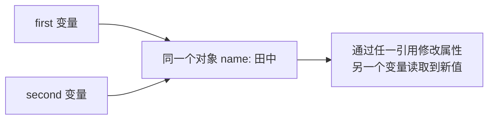

# 第 9 章 对象基础与业务数据

## 学习目标

完成本章后，你应能够：

- 使用对象字面量创建和组织业务数据。
- 读取、新增、修改和删除对象属性。
- 区分点语法和方括号语法的使用场景。
- 处理嵌套对象和对象数组。
- 遍历对象，并判断属性是否属于对象自身。
- 说明对象赋值、修改和比较时的引用特点。

## 掌握要求

- **必须掌握**：对象字面量、属性操作、嵌套对象、对象数组、常用遍历方式和引用特点。
- **需要掌握**：计算属性名、属性存在性判断、浅复制和 `structuredClone()` 的适用边界。
- **下一章学习**：对象方法、`this`、构造函数、实例、`prototype` 和原型链。
- **后续学习**：对象解构、完整展开语法、`Map`、`Set`、`Proxy` 和 `Reflect`。

## 示例运行约定

本章不需要页面控件，示例主要观察控制台输出。创建 `object-demo.html` 和同目录的 `object-demo.js`：

```html
<!DOCTYPE html>
<html lang="zh-CN">
<head>
  <meta charset="UTF-8">
  <title>对象实验</title>
  <script src="object-demo.js" defer></script>
</head>
<body>
  <p>打开开发者工具的 Console，查看对象实验结果。</p>
</body>
</html>
```

每个独立实验都替换整个 `object-demo.js`，保存后刷新。同一小节中明确要求追加的代码，放在该小节已有代码之后；不要把整章所有示例拼成一个文件，否则重复声明 `const user` 等变量会报错。错误示例单独实验，观察后移除。

## 1. 认识和创建对象

### 1.1 对象解决什么问题

对象用于把一条数据的多个相关字段组织在一起。

```js
const user = {
  accountId: "yamada.taro",
  name: "山田 太郎",
  department: "development",
  employeeNumber: "EMP-00001"
};
```

对象中的每一项都是一组“属性名和属性值”：

```text
accountId: "yamada.taro"
属性名       属性值
```

- 属性名也称为键，即 key。
- 属性值也称为 value，可以是任意 JavaScript 数据类型。
- 不同属性之间使用逗号分隔。

数组适合保存一组有顺序的数据，对象适合描述一条数据有哪些字段。项目中经常用数组保存多条记录，再用对象描述每条记录。

### 1.2 使用对象字面量创建对象

使用 `{}` 创建对象的写法称为对象字面量，是项目中最常用的方式。

```js
const application = {
  id: "REQ-20260820-001",
  leaveType: "paid",
  days: 2,
  urgent: false,
  note: "",
  approver: null
};
```

一个对象可以同时保存不同类型的值：

| 属性 | 值 | 数据类型 | 含义 |
| --- | --- | --- | --- |
| `id` | `"REQ-20260820-001"` | string | 申请编号 |
| `days` | `2` | number | 申请天数 |
| `urgent` | `false` | boolean | 是否紧急 |
| `note` | `""` | string | 当前是空字符串 |
| `approver` | `null` | null | 当前没有审批人 |

空对象写作 `{}`。虽然之后可以逐步添加属性，但业务对象通常应在创建时写出稳定的主要字段，方便理解数据结构。

## 2. 操作对象属性

### 2.1 读取对象属性

#### 2.1.1 点语法

属性名固定并且是普通标识符时，优先使用点语法。这个独立实验包含对象创建和读取：

```js
const user = {
  name: "山田 太郎",
  department: "development"
};

console.log(user.name);       // 山田 太郎
console.log(user.department); // development
```

点号左边是要读取的对象，右边是确定的属性名。

#### 2.1.2 方括号语法

属性名来自变量时，使用方括号。独立实验：

```js
const user = { name: "山田 太郎", department: "development" };
const key = "department";

console.log(user[key]);   // development
console.log(user["key"]); // undefined
console.log(user.key);    // undefined
```

`user[key]` 先读取变量 `key` 的值，再查找名为 `department` 的属性。`user["key"]` 和 `user.key` 都查找固定名称 `key`，本例没有这个属性。把变量值改为 `"name"`，第一行读取结果随之变为姓名。

属性名包含连字符等特殊字符时，也需要方括号。下面是另一个独立实验：

```js
const labels = {
  "display-name": "显示名称"
};

console.log(labels["display-name"]); // 显示名称
```

带特殊字符的属性名在创建时加引号，访问时写成 `对象["属性名"]`。不能写 `labels.display-name`，那会被理解为减法表达式。

#### 2.1.3 读取不存在的属性

读取不存在的属性得到 `undefined`：

```js
const user = { name: "山田" };
console.log(user.phoneNumber); // undefined
```

在这段代码后单独追加下面的错误示例，会因为 `user.manager` 是 `undefined` 而报错：

```js
console.log(user.manager.name);
// TypeError: Cannot read properties of undefined
```

修正时不能只看最后的 `name`，要先确认中间的 `manager` 是否存在。用下面完整脚本替换错误实验：

```js
const user = { name: "山田", manager: null };

if (user.manager !== null && user.manager !== undefined) {
  console.log(user.manager.name);
} else {
  console.log("暂未设置负责人");
}
```

`&&` 从左向右判断，两个条件都成立才进入读取分支。本例假定 `manager` 只可能是负责人对象、`null` 或未设置；来自外部的不确定数据还要检查类型和字段。

先运行应输出“暂未设置负责人”；再把 `manager: null` 改为 `manager: { name: "佐藤" }`，应输出“佐藤”。第 11 章的可选链 `?.` 可以简化这类取值，当前使用 `if` 已能处理缺失情况。

### 2.2 新增、修改和删除属性

#### 2.2.1 修改已有属性

```js
const user = { department: "development" };
user.department = "quality";
console.log(user.department); // quality

user["department"] = "sales";
console.log(user.department); // sales
```

点语法和方括号都能赋值。属性已经存在时，是修改它的值。

#### 2.2.2 新增属性

为不存在的属性赋值，会创建新属性：

```js
const user = { name: "山田" };
user.email = "yamada@example.com";
user["active"] = true;

console.log(user.email);  // yamada@example.com
console.log(user.active); // true
```

#### 2.2.3 使用 `delete` 删除属性

```js
const user = { name: "山田", email: "yamada@example.com" };
delete user.email;
console.log(user.email); // undefined
```

`delete` 删除对象属性，本例删除成功，表达式结果为 `true`。它不是把属性值改为空，而是移除这个属性；后面的属性存在性判断可以验证区别。

业务数据如果要求结构稳定，通常更适合保留属性并设置为 `null` 或约定值，而不是随意删除。

#### 2.2.4 `const` 对象仍能修改属性

```js
const user = { name: "山田 太郎" };
user.name = "山田 花子";
console.log(user.name); // 山田 花子
```

`const` 禁止变量重新指向另一个值，但不会自动冻结对象内部。在上面脚本末尾单独追加以下错误示例：

```js
user = { name: "鈴木 一郎" };
// TypeError: Assignment to constant variable
```

修改 `user.name` 是修改原对象的内容；给 `user` 重新赋值，是要求变量指向另一个对象。这两种操作不同。

### 2.3 判断属性是否存在

#### 2.3.1 自有属性与继承属性

直接定义在对象上的属性叫**自有属性**。对象还可以沿着一种称为“原型”的关联关系，找到其他对象提供的属性或方法，这些称为**继承属性**。例如普通对象通常可以使用继承来的 `toString` 方法，即使没有在自己的花括号里定义它。

这里只比较“自己有”和“能找到”，原型的创建和查找过程见第 8 节。`in` 检查自己或原型上能否找到属性；`Object.hasOwn()` 只检查对象自身。

```js
const application = { id: "REQ-001", status: "pending" };

console.log("status" in application);                // true
console.log("toString" in application);              // true
console.log(Object.hasOwn(application, "status"));   // true
console.log(Object.hasOwn(application, "toString")); // false
```

这里检查的是名为 `toString` 的方法是否存在，没有调用它。`toString()` 通常用于字符串表示，但当前不需要依靠它转换业务数据。

`Object.hasOwn()` 返回布尔值，参数如下：

| 参数 | 可接受的值 | 是否必填 | 作用 |
| --- | --- | --- | --- |
| 第一个参数 | 要检查的对象 | 必填 | 指定检查对象 |
| 第二个参数 | 属性名字符串；也支持后续学习的 Symbol 键 | 必填 | 指定属性名 |

旧代码中的 `application.hasOwnProperty("status")` 也用于判断自有属性。新代码优先使用 `Object.hasOwn(application, "status")`，即使对象自定义了同名 `hasOwnProperty` 属性，也不会影响调用。

#### 2.3.2 属性存在不等于属性有值

```js
const data = { reason: undefined };

console.log(data.reason);                          // undefined
console.log(data.missingReason);                   // undefined
console.log(Object.hasOwn(data, "reason"));         // true
console.log(Object.hasOwn(data, "missingReason"));  // false

delete data.reason;
console.log(Object.hasOwn(data, "reason"));         // false
```

值为 `undefined` 时，属性仍然可以存在；`delete` 才移除了它。需要判断“是否定义了这个字段”时，不能只检查读取结果。

同样，值为 `0`、`false`、`""` 不表示字段不存在。不能用 `if (data.someField)` 代替属性存在性检查。

## 3. 属性名与简写形式

### 3.1 普通属性名

普通标识符形式的属性名可以不加引号：

```js
const user = {
  name: "山田 太郎",
  department: "development"
};
```

包含连字符、空格等特殊字符时，需要使用字符串形式：

```js
const labels = {
  "display-name": "显示名称",
  "help text": "帮助文字"
};
```

### 3.2 属性简写

属性名与已有变量名相同时，可以只写变量名：

```js
const name = "山田";
const status = "pending";
const user = { name, status };
console.log(user); // { name: "山田", status: "pending" }
```

`{ name, status }` 等价于 `{ name: name, status: status }`。冒号左侧是属性名，右侧是变量的值；简写不是省略变量声明，`name` 和 `status` 必须已存在。属性值为函数时也适用。

### 3.3 计算属性名

属性名来自变量或表达式时，在对象字面量中使用 `[]`：

```js
const statusKey = "pending";

const statusLabels = {
  [statusKey]: "申請中"
};

console.log(statusLabels.pending); // 申請中
```

实际创建的属性名是变量保存的 `"pending"`，不是字符串 `"statusKey"`。

先确认自己能创建一条对象、读取一个属性并修改它。接下来改变的不是读写规则，而是数据规模：一个属性可以保存另一条对象，一个数组可以保存多条对象。

## 4. 使用对象组织业务数据

### 4.1 嵌套对象

对象的属性值还可以是另一个对象：

```js
const user = {
  employeeNumber: "EMP-00001",
  name: "山田 太郎",
  department: {
    code: "DEV",
    name: "開発部"
  },
  contact: {
    email: "yamada@example.com",
    extensionNumber: "1234"
  }
};
```

从外到内逐层读取和修改：

```js
console.log(user.department.name); // 開発部
user.department.name = "品質管理部";
```

嵌套结构应以业务含义为准。层级过深会增加读取和修改的难度。

### 4.2 对象数组

实际项目经常使用“数组保存多条记录，对象描述每条记录”的结构。

```js
const applications = [
  {
    id: "REQ-20260820-001",
    status: "pending",
    applicant: {
      employeeNumber: "EMP-00001",
      name: "山田 太郎"
    }
  },
  {
    id: "REQ-20260821-001",
    status: "approved",
    applicant: {
      employeeNumber: "EMP-00002",
      name: "鈴木 花子"
    }
  }
];
```

读取第一条记录：

```js
console.log(applications[0].id);
console.log(applications[0].applicant.name);
```

依次处理所有记录：

```js
for (const application of applications) {
  console.log(`${application.id}: ${application.applicant.name}`);
}
```

第 8 章用数字学习了数组回调。对象数组也一样，只是回调接收的是一条记录，需要读取属性后再判断。

#### 4.2.1 查找一条记录

`find()` 在第 8 章用于查找数组元素。对象数组中，回调参数每次收到一条对象，需要按属性判断。独立实验：

```js
const applications = [
  { id: "REQ-001", days: 1 },
  { id: "REQ-002", days: 2 }
];

const target = applications.find(app => app.id === "REQ-002");
if (target !== undefined) {
  console.log(target.days); // 2
} else {
  console.log("没有找到申请");
}
```

`app` 是回调参数名，不是特殊关键字。`app.id` 读取当前记录编号。把目标编号改为 `"REQ-999"` 再运行，验证未找到分支。

#### 4.2.2 筛选多条记录

`filter()` 保留符合条件的元素，返回新数组。独立实验：

```js
const applications = [
  { id: "REQ-001", status: "pending" },
  { id: "REQ-002", status: "approved" },
  { id: "REQ-003", status: "pending" }
];

const pendingApplications = applications.filter(app => app.status === "pending");
console.log(pendingApplications.length); // 2
console.log(pendingApplications[0].id);  // REQ-001
```

把筛选条件改为 `"approved"`，结果应只有一条。没有匹配项时得到空数组，不是 `undefined`。

#### 4.2.3 提取一组属性值

`map()` 把每个元素转换成回调返回的值。独立实验：

```js
const applications = [
  { id: "REQ-001", days: 1 },
  { id: "REQ-002", days: 2 }
];

const ids = applications.map(app => app.id);
console.log(ids); // ["REQ-001", "REQ-002"]
```

原数组保存对象，结果数组保存字符串。把 `app.id` 改为 `app.days`，结果应为 `[1, 2]`。这里没有修改原记录。

#### 4.2.4 汇总数值

`reduce()` 把每条记录的数值累加到一个结果中。独立实验：

```js
const applications = [
  { id: "REQ-001", days: 1 },
  { id: "REQ-002", days: 2 },
  { id: "REQ-003", days: 3 }
];

const totalDays = applications.reduce((total, app) => total + app.days, 0);
console.log(totalDays); // 6
```

初始累计值为 `0`，每次加上当前记录的 `days`，依次得到 `1 → 3 → 6`。把数组改为空数组再运行，结果为 `0`。

#### 4.2.5 排序时保留原数组顺序

`sort()` 会直接改变调用它的数组。`slice()` 不传参数时，先复制整个数组，再对复制结果排序：

```js
const applications = [
  { id: "REQ-001", days: 1 },
  { id: "REQ-002", days: 3 },
  { id: "REQ-003", days: 2 }
];

const sortedApplications = applications.slice();
sortedApplications.sort((a, b) => b.days - a.days);

console.log(sortedApplications[0].id); // REQ-002
console.log(applications[0].id);       // REQ-001
```

`b.days - a.days` 按天数降序排列。这只保证原数组的顺序不变，并不表示每条对象记录也被复制；第 6 节继续验证对象引用。

阶段练习：独立筛选已批准的记录，再统计它们的天数；使用 `some()` 判断是否有待审批记录，使用 `every()` 检查所有记录的天数是否大于零。

### 4.3 映射对象与稳定的数据结构

映射对象可以把程序保存值转换成页面显示文字：

```js
const statusLabels = {
  pending: "申請中",
  approved: "承認済",
  rejected: "差戻し",
  cancelled: "取消済"
};

const application = {
  id: "REQ-001",
  status: "pending"
};

console.log(statusLabels[application.status]); // 申請中
```

这里必须使用方括号，因为属性名来自 `application.status` 的值。

同一类业务对象应尽量保持相同字段名称和数据类型：

```js
const applications = [
  { id: "REQ-001", status: "pending", approver: null },
  { id: "REQ-002", status: "approved", approver: "EMP-00010" }
];
```

- `""` 表示字符串字段当前为空。
- `null` 通常表示有这个字段，但当前明确没有值。
- `undefined` 常表示没有赋值或读取了不存在的属性。

稳定结构更容易校验、渲染，也便于后续使用 TypeScript 描述对象类型。

## 5. 遍历对象属性

### 5.1 使用 `for...in`

可枚举属性是允许出现在这类属性遍历中的属性。通过对象字面量创建的普通字段，默认可枚举；并非对象上所有能访问的属性都会被遍历出来，例如通常继承的 `toString` 不可枚举。

`for...in` 每次取得一个可枚举的字符串属性名，也可能遍历到继承的可枚举属性，因此配合 `Object.hasOwn()` 限制为自身字段：

```js
const application = {
  id: "REQ-001",
  leaveType: "paid",
  status: "pending"
};

for (const key in application) {
  if (Object.hasOwn(application, key)) {
    console.log(key, application[key]);
  }
}
```

示例输出：

```text
id REQ-001
leaveType paid
status pending
```

`key` 是变量，因此读取值时必须写 `application[key]`。`Object.hasOwn()` 用于排除从原型继承的属性。

### 5.2 `Object.keys()`、`Object.values()` 和 `Object.entries()`

下面三种方法分别把对象自身可枚举的字符串属性名、属性值和键值对组成数组。它们不会把继承属性一起收集。独立实验：

```js
const application = { id: "REQ-001", leaveType: "paid", status: "pending" };

console.log(Object.keys(application));
// ["id", "leaveType", "status"]

console.log(Object.values(application));
// ["REQ-001", "paid", "pending"]

console.log(Object.entries(application));
// [["id", "REQ-001"], ["leaveType", "paid"], ["status", "pending"]]
```

| 方法 | 参数及可接受值 | 默认值 | 返回值 |
| --- | --- | --- | --- |
| `Object.keys(object)` | 要读取的对象，必填 | 无 | 自有可枚举属性名数组 |
| `Object.values(object)` | 要读取的对象，必填 | 无 | 自有可枚举属性值数组 |
| `Object.entries(object)` | 要读取的对象，必填 | 无 | `[属性名, 属性值]` 数组 |

在上面的脚本末尾追加以下代码，同时取得键和值：

```js
for (const entry of Object.entries(application)) {
  const key = entry[0];
  const value = entry[1];
  console.log(key, value);
}
```

`entry` 是一个包含两项的数组：`entry[0]` 为属性名，`entry[1]` 为属性值。这里沿用第 4 章的下标读取。

不要使用 `for...in` 遍历数组。数组需要按元素处理时优先使用 `for...of` 或数组方法。

## 6. 理解对象的引用特点

先运行下面的实验，再对照图解判断两个变量是否指向同一个对象。

<JSRunDemo example="references" />

变量保存的是对象引用。把一个变量赋给另一个变量，不会自动复制对象内部的数据：



原始值赋值时会复制值本身：

```js
let statusA = "pending";
let statusB = statusA;
statusB = "approved";

console.log(statusA); // pending
```

对象赋值时，两个变量会指向同一个对象：

```js
const applicationA = { status: "pending" };
const applicationB = applicationA;

applicationB.status = "approved";

console.log(applicationA.status); // approved
console.log(applicationB.status); // approved
```

### 6.1 对象比较的是引用

```js
const applicationA = { id: "REQ-001" };
const applicationB = { id: "REQ-001" };
const applicationC = applicationA;

console.log(applicationA === applicationB); // false
console.log(applicationA === applicationC); // true
```

内容看起来相同的两个对象，仍然是分别创建的对象。严格相等比较的是它们是否为同一个对象。

直接赋值不是复制对象。下面继续比较浅复制和深复制。

### 6.2 浅复制

只创建新的最外层对象，而把属性值直接赋给它，嵌套对象仍然共享引用，这称为**浅复制**。

```js
const original = {
  id: "REQ-001",
  applicant: { name: "山田" }
};

const copied = {
  id: original.id,
  applicant: original.applicant
};
copied.id = "REQ-002";
copied.applicant.name = "鈴木";

console.log(original.id);             // REQ-001
console.log(original.applicant.name); // 鈴木
```

最外层的 `id` 已经独立，但 `applicant` 仍指向同一个对象。这是逐个属性赋值，和直接写 `const copied = original` 不同：后者连最外层对象也没有新建。

### 6.3 使用 structuredClone() 深复制

**深复制**会为嵌套数据也创建独立副本。`structuredClone(value)` 使用浏览器的结构化克隆算法复制支持的数据：

```js
const original = {
  applicant: { name: "山田" },
  dates: ["2026-09-01", "2026-09-02"]
};

const copied = structuredClone(original);
copied.applicant.name = "鈴木";

console.log(original.applicant.name); // 山田
console.log(copied.applicant.name);   // 鈴木
```

`structuredClone()` 不能复制函数和 DOM 节点，复制类实例时也不会保留完整的自定义原型行为。不要使用 `JSON.stringify()` 和 `JSON.parse()` 充当通用深复制方法，因为它们会丢失部分数据类型。

### 6.4 对象作为函数参数

把对象交给函数时，参数得到的是同一对象的引用值。通过参数修改属性，会影响调用者正在使用的对象：

```js
const application = { status: "pending" };

function approve(target) {
  target.status = "approved";
}

approve(application);
console.log(application.status); // approved
```

调用时 `application` 和参数 `target` 都指向同一条记录。`target.status = ...` 修改的就是这条记录。

但给参数重新赋值，只改变函数内部参数指向哪里。独立对照实验：

```js
const application = { status: "pending" };

function replaceApplication(target) {
  target = { status: "approved" };
  console.log(target.status); // approved
}

replaceApplication(application);
console.log(application.status); // pending
```

参数 `target` 改为指向新对象，外面的 `application` 仍指向原对象。JavaScript 传递的是值；对象情况下，这个值是引用，不是把外部变量本身交给函数重新绑定。

### 6.5 函数返回新对象

需要创建结构一致的数据，或者修改时保留原值，可以让普通函数返回一个新对象：

```js
function createUser(name) {
  return {
    name: name,
    active: true
  };
}

const firstUser = createUser("山田");
const secondUser = createUser("山田");
firstUser.active = false;

console.log(firstUser.active);             // false
console.log(secondUser.active);            // true
console.log(firstUser === secondUser);     // false
```

每调用一次，函数中的对象字面量就创建一个新对象，再由 `return` 交给调用者。这是“函数返回对象”，不等于“对象的方法”。

箭头函数也可以返回新对象。下面是相同功能的独立替代写法：

```js
const createUser = name => ({
  name: name,
  active: true
});

console.log(createUser("山田").name); // 山田
```

箭头函数在没有代码块时会返回表达式的值。`({ ... })` 外层圆括号让花括号被理解为对象表达式；如果写成函数代码块，就要像普通函数一样显式写 `return`。

### 6.6 对象数组中的引用

#### 6.6.1 find() 返回的对象不是副本

```js
const applications = [
  { id: "REQ-001", status: "pending" },
  { id: "REQ-002", status: "pending" }
];

const target = applications.find(app => app.id === "REQ-002");
if (target !== undefined) {
  target.status = "approved";
}

console.log(applications[1].status); // approved
```

`find()` 返回数组中匹配元素的值；本例元素是对象，因此通过 `target` 修改属性，会修改原记录。这适合“查到申请后更新它”，不适合在未保存的编辑预览中直接改原数据。

#### 6.6.2 新数组也可能共享原来的对象

```js
const applications = [
  { id: "REQ-001", status: "pending" },
  { id: "REQ-002", status: "approved" }
];

const pending = applications.filter(app => app.status === "pending");
pending[0].status = "cancelled";

console.log(pending === applications);       // false
console.log(pending[0] === applications[0]);  // true
console.log(applications[0].status);          // cancelled
console.log(pending.length);                 // 1
```

数组是新建的，但保留下来的元素仍引用原对象。修改状态后，`pending` 不会自动重新筛选，所以长度仍为 1。

`slice()` 也有相同的浅复制特点。独立实验：

```js
const applications = [{ id: "REQ-001", days: 1 }];
const copied = applications.slice();

copied[0].days = 5;
console.log(applications[0].days); // 5

copied.push({ id: "REQ-002", days: 2 });
console.log(copied.length);       // 2
console.log(applications.length); // 1
```

修改共享记录的属性会相互影响；向新数组追加元素，不会给原数组追加元素。`map()` 是否得到新对象取决于回调：返回原对象仍共享引用，返回对象字面量才会创建新对象。

### 6.7 什么时候选择赋值、浅复制或深复制

| 需求 | 选择 | 需要注意 |
| --- | --- | --- |
| 查到一条记录后直接更新它 | 使用原对象引用 | 所有引用该对象的位置都会看到修改 |
| 改变列表顺序，不改记录本身 | 浅复制数组再排序 | 数组独立，记录仍可能共享 |
| 只修改副本的顶层字段 | 新建对象并复制所需属性 | 嵌套对象和数组仍可能共享 |
| 编辑包含嵌套数据的草稿，不影响原记录 | 对支持的数据使用 `structuredClone()` | 先确认没有函数、DOM 节点等不支持的数据 |

不需要每次都深复制。先确认“哪些内容必须独立”，再决定复制范围。下面对照实验只观察普通嵌套数据，不涉及浏览器存储：

```js
const original = { contact: { name: "山田" } };
const draft = structuredClone(original);

draft.contact.name = "佐藤";
console.log(original.contact.name); // 山田
console.log(draft.contact.name);    // 佐藤
```

### 6.8 用递归理解深复制过程（了解即可）

下面的函数只演示普通数组和普通对象如何逐层复制，不是通用克隆库：

```js
function clonePlainData(value) {
  if (Array.isArray(value)) {
    return value.map(clonePlainData);
  }

  if (value !== null && typeof value === "object") {
    const result = {};

    for (const key in value) {
      if (Object.hasOwn(value, key)) {
        result[key] = clonePlainData(value[key]);
      }
    }

    return result;
  }

  return value;
}
```

它没有处理循环引用、`Date`、`Map`、`Set`、函数、DOM节点和对象原型。实际项目应先确认数据类型和复制目的，再选择浅复制或 `structuredClone()`。

## 7. 本章练习

创建一条包含员工编号、姓名、部门和联系信息的对象，再创建一个保存两条员工记录的数组：

1. 读取第一条记录的姓名和联系信息。
2. 修改第一条记录的部门，并验证数组中的记录同步变化。
3. 使用 `Object.keys()` 输出一条记录的属性名。
4. 创建一份浅复制，修改其嵌套联系信息，观察原对象是否变化并解释原因。

本章先处理对象中的数据。对象方法、`this` 和原型在下一章继续学习。

