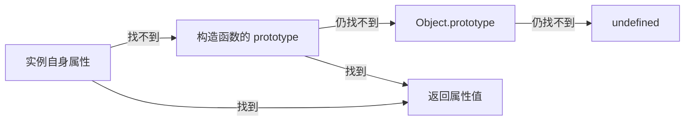

# 第 10 章 对象方法、this 与原型基础

本章继续使用上一章的对象知识，学习对象方法、`this`、构造函数和原型。沿用上一章的 `object-demo.html`，每个独立实验替换 `object-demo.js` 的内容，不把同名变量的示例拼在一起。

完成本章后，你应能定义对象方法，判断不同调用方式中的 `this`，并看懂构造函数、实例、`prototype` 和原型链的基础代码。`call()`、`apply()`、`bind()` 和原型链细节以识读既有代码为目标。

## 1. 对象方法与 `this`

### 1.1 定义和调用对象方法

属性值也可以是函数，保存在对象属性中的函数通常称为方法。先观察不需要 `this` 的独立示例：

```js
const calculator = {
  double: function (value) {
    return value * 2;
  }
};

console.log(calculator.double);    // 输出函数本身
console.log(calculator.double(3)); // 6
```

- `calculator.double` 取得函数，但不执行。
- `calculator.double(3)` 调用方法，把 `3` 传给参数 `value`，再取得返回值。
- `double` 是本例自己定义的方法名，不是 JavaScript 内置方法。

#### 7.1.1 方法简写

对象字面量中可以把 `double: function (value)` 简写为 `double(value)`。下面是完整替代版本：

```js
const calculator = {
  double(value) {
    return value * 2;
  }
};

console.log(calculator.double(3)); // 6
```

两种写法在这个实验中完成相同任务。接下来让方法读取它所属对象的字段，就需要认识 `this`。

### 1.2 先记住判断原则：看调用方式

`this` 是函数执行时取得的一个值，用于表示“本次调用时正在操作的对象”。它不是固定的对象名称，也不能只看函数写在哪里来判断。

判断普通函数中的 `this` 时，先看函数怎样被调用：

| 调用方式 | 示例 | 普通函数中的 `this` |
| --- | --- | --- |
| 对象方法调用 | `application.showStatus()` | 点号左侧的 `application` |
| 单独调用 | `showStatus()` | 严格模式下是 `undefined`；非严格的浏览器普通脚本中通常是 `window` |
| 指定对象后调用 | `showStatus.call(application)` | `call()` 指定的 `application` |
| 构造调用 | `new Application()` | `new` 创建的新对象 |
| 箭头函数 | `() => {}` | 不创建自己的 `this`，使用外层作用域的 `this` |

新人最常用的是“对象方法调用”。看到 `对象.方法()` 时，普通方法内的 `this` 通常就是点号左侧的对象。

### 1.3 作为对象方法调用

用 `application.showStatus()` 调用普通方法时，`this` 指向点号左侧的 `application`。因此方法可以通过 `this.status` 读取当前调用对象的状态：

```js
const application = {
  id: "REQ-001",
  status: "pending",
  showStatus() {
    console.log(`${this.id}: ${this.status}`);
  }
};

application.showStatus(); // REQ-001: pending
```

`this.id` 和 `this.status` 分别读取“本次调用者”的两个属性。这样的方法不必把对象名称 `application` 写死，能够复用于其他具有相同字段的对象。

`this` 不是在定义函数时永久绑定到某个对象。下面是独立实验：同一个函数放到两个对象上，由谁以方法形式调用，就读取谁的姓名。

```js
function showName() {
  console.log(this.name);
}

const userA = { name: "山田 太郎", showName };
const userB = { name: "鈴木 花子", showName };

userA.showName(); // 山田 太郎
userB.showName(); // 鈴木 花子
```

下面是独立实验，观察方法怎样修改当前对象：

```js
const application = { status: "pending" };

application.changeStatus = function (nextStatus) {
  this.status = nextStatus;
  return this.status;
};

console.log(application.changeStatus("approved")); // approved
console.log(application.status);                   // approved
```

这里通过属性赋值添加方法，参数 `nextStatus` 接收新状态。`this.status` 修改本次调用该方法的对象，`return` 把修改后的值交给调用者。

### 1.4 方法被单独取出后，调用者会丢失

下面的 `showStatus` 变量只保存函数本身，不再保留前面的 `application.`：

```js
"use strict";

const application = {
  status: "pending",
  showStatus() {
    console.log(this.status);
  }
};

const showStatus = application.showStatus;
showStatus();
// TypeError: Cannot read properties of undefined
```

`"use strict"` 开启严格模式。严格模式下直接写 `showStatus()` 调用普通函数时，`this` 是 `undefined`，所以不能继续读取 `this.status`。

即使函数最初写在 `application` 对象中，把它取出后单独调用，也不会自动记住原对象。常见修正方式有两种：

```js
application.showStatus(); // 保留“对象.方法()”调用

const boundShowStatus = application.showStatus.bind(application);
boundShowStatus(); // 使用 bind() 固定调用对象
```

`bind(object)` 返回一个新函数，并把新函数运行时的 `this` 固定为指定对象。它不会立即执行原函数。

### 1.5 使用 `call()`、`apply()` 和 `bind()` 指定 `this`

这三个函数方法都能明确指定普通函数中的 `this`，区别在于是否立即调用以及怎样传入参数。

```js
function showApplication(prefix, suffix) {
  console.log(`${prefix}${this.id}${suffix}`);
}

const application = { id: "REQ-001" };

showApplication.call(application, "申请：", "（确认中）");
showApplication.apply(application, ["申请：", "（确认中）"]);

const boundShowApplication = showApplication.bind(
  application,
  "申请：",
  "（确认中）"
);
boundShowApplication();
```

三行都会输出 `申请：REQ-001（确认中）`。

| 方法 | 是否立即执行 | 参数写法 | 返回值 |
| --- | --- | --- | --- |
| `call(thisArg, arg1, arg2)` | 是 | 参数逐个传入 | 原函数的返回值 |
| `apply(thisArg, argsArray)` | 是 | 参数放在数组中 | 原函数的返回值 |
| `bind(thisArg, arg1, arg2)` | 否 | 可先传入部分或全部参数 | 固定了 `this` 的新函数 |

第一个参数 `thisArg` 是希望函数内部 `this` 指向的对象。`call()` 和 `apply()` 适合“现在就用指定对象执行”，`bind()` 适合“把函数交给其他代码，稍后再执行”。业务代码不需要为了使用 `this` 而刻意调用它们，但应能看懂既有代码。

### 1.6 箭头函数没有自己的 `this`

不要使用箭头函数定义依赖对象自身 `this` 的方法。下面虽然写在 `user` 对象中，但箭头函数不会因为 `user.showName()` 这种调用方式而得到 `user`：

```js
const user = {
  name: "山田 太郎",
  showName: () => {
    console.log(this.name);
  }
};
```

在本章的普通浏览器脚本中，这个箭头函数使用外层脚本的 `this`，而不是 `user`，所以结果不会是“山田 太郎”。需要读取当前对象时，改用普通方法简写：

```js
const user = {
  name: "山田 太郎",
  showName() {
    console.log(this.name);
  }
};

user.showName(); // 山田 太郎
```

箭头函数适合放在普通方法内部作为回调，因为它会沿用外层普通方法的 `this`：

```js
const application = {
  id: "REQ-001",
  reviewers: ["佐藤", "鈴木"],
  showReviewers() {
    this.reviewers.forEach((reviewer) => {
      console.log(`${this.id}: ${reviewer}`);
    });
  }
};

application.showReviewers();
// REQ-001: 佐藤
// REQ-001: 鈴木
```

`showReviewers()` 是普通方法，所以其中的 `this` 是 `application`。内部箭头函数不创建新 `this`，继续使用外层方法的 `this`。`forEach()` 已在第 8 章讲解，本例只观察 `this` 的传递。

### 1.7 构造函数调用与事件监听中的 `this`

使用 `new Application()` 调用构造函数时，构造函数中的 `this` 指向本次创建的新对象。完整创建过程和示例见下一节。

在 DOM 事件监听中，普通监听函数里的 `this` 通常与 `event.currentTarget` 相同，指向注册监听器的元素；箭头函数仍然没有自己的 `this`。为了让代码含义更明确，事件处理中优先读取 `event.currentTarget`。事件对象与传播过程见[第 13 章](13_events_forms.md)。

```js
const saveButton = document.querySelector("#saveButton");

saveButton.addEventListener("click", function (event) {
  console.log(this === event.currentTarget); // true
});
```

这个片段要求 HTML 中存在 `<button id="saveButton" type="button">保存</button>`。这里使用普通函数只是为了观察 `this`；业务代码使用 `event.currentTarget` 更容易表达“触发当前监听器的元素”。

### 1.8 判断 `this` 的顺序

遇到 `this` 时按下面顺序检查：

1. 是箭头函数吗？如果是，去外层作用域寻找 `this`。
2. 是通过 `new` 调用吗？如果是，`this` 是新对象。
3. 使用了 `call()`、`apply()` 或 `bind()` 吗？如果是，查看指定的对象。
4. 是 `对象.方法()` 吗？如果是，`this` 是点号左侧对象。
5. 只是 `函数()` 吗？严格模式下 `this` 是 `undefined`，不要依赖非严格模式下的隐式全局对象。

关键不是背住某个函数“属于谁”，而是找到本次调用时采用了哪一种形式。

## 2. 构造函数、实例与原型

### 2.1 构造函数与实例

需要按照相同规则反复创建对象时，可以使用构造函数。构造函数本质上仍是函数，约定以大写字母开头，并使用 `new` 调用。

```js
function Application(id, leaveType, status) {
  this.id = id;
  this.leaveType = leaveType;
  this.status = status;
}

const applicationA = new Application("REQ-001", "paid", "pending");
const applicationB = new Application("REQ-002", "half-pm", "approved");
```

- `Application` 是构造函数。
- `new Application(...)` 创建并返回一个新对象。
- `applicationA` 和 `applicationB` 是两个不同实例。
- 构造函数中的 `this` 指向本次新创建的对象。

```js
console.log(applicationA.id);     // REQ-001
console.log(applicationB.status); // approved
console.log(applicationA === applicationB); // false
```

#### 8.1.1 `new` 的基本过程

1. 创建一个新对象。
2. 让构造函数中的 `this` 指向新对象。
3. 执行构造函数，为新对象设置属性。
4. 构造函数没有显式返回其他对象时，返回这个新对象。

忘记 `new` 时，在现代严格模式或 ES 模块中会因为 `this` 是 `undefined` 而报错。看到首字母大写的构造函数时，应使用 `new` 调用。

### 2.2 `prototype` 与共享方法

如果在构造函数内部创建方法，每个实例会得到不同的函数对象：

```js
function Application(id) {
  this.id = id;
  this.showId = function () {
    console.log(this.id);
  };
}

const applicationA = new Application("REQ-001");
const applicationB = new Application("REQ-002");

console.log(applicationA.showId === applicationB.showId); // false
```

实例可以访问构造函数 `prototype` 对象上的方法，因此共享方法通常放到原型上：

```js
function Application(id, status) {
  this.id = id;
  this.status = status;
}

Application.prototype.showStatus = function () {
  console.log(`${this.id}: ${this.status}`);
};

const applicationA = new Application("REQ-001", "pending");
const applicationB = new Application("REQ-002", "approved");

applicationA.showStatus(); // REQ-001: pending
applicationB.showStatus(); // REQ-002: approved
console.log(applicationA.showStatus === applicationB.showStatus); // true
```

### 2.3 原型链查找

运行后比较实例自身与原型上是否有 `greet`，再对照下面的查找路径。

<JSRunDemo example="prototype" />

查找属性时，JavaScript 先检查实例自身；找不到才沿原型链继续向上查找。



读取对象属性时，JavaScript 会按顺序查找：

1. 先查找对象自身。
2. 没有时，到对象的原型上查找。
3. 沿着原型继续向上查找。
4. 到达原型链终点仍未找到时，返回 `undefined`。

下面代码追加到 8.2 的第二个完整示例末尾，复用其中的 `Application` 和 `applicationA`：

```js
console.log(Object.hasOwn(applicationA, "id"));         // true
console.log(Object.hasOwn(applicationA, "showStatus")); // false
console.log("showStatus" in applicationA);              // true

console.log(
  Object.getPrototypeOf(applicationA) === Application.prototype
); // true
```

`Object.getPrototypeOf(object)` 接收要检查的对象，返回它的直接原型（可能为 `null`）。本例返回 `Application.prototype`，所以比较结果为 `true`。

`id` 是实例的自有属性；`showStatus` 位于原型上，但实例仍能沿原型链访问它。

旧代码和控制台中可能看到 `__proto__`，新代码不要依赖它修改原型。零基础阶段重点理解“先查自身，再沿原型向上查找”。现代项目也常使用 `class`，构造函数和原型知识有助于阅读旧项目并理解 JavaScript 的对象机制。

## 3. 常见错误与排查

| 现象 | 原因 | 修正方式 |
| --- | --- | --- |
| `user.key` 得不到变量指定的属性 | 点语法把 `key` 当成固定属性名 | 改为 `user[key]` |
| 特殊属性名访问时报错 | 对包含连字符的属性使用了点语法 | 改为 `object["content-type"]` |
| 调用方法没有结果 | 只写了 `user.showName` | 写成 `user.showName()` |
| 方法中的 `this` 不是当前对象 | 使用箭头函数定义了依赖自身 `this` 的方法 | 使用普通方法简写 |
| 取出方法后调用时报错 | `const fn = object.method` 丢失了方法调用者 | 保留 `object.method()` 调用，或使用 `bind()` |
| `call()`、`apply()` 执行过早 | 它们会立即调用函数 | 需要稍后执行时使用 `bind()` 返回新函数 |
| 修改副本时原对象也变化 | 直接赋值只复制了对象引用 | 根据嵌套层级选择浅复制或 `structuredClone()` |
| 两个内容相同的对象比较为 `false` | `===` 比较对象引用 | 按需要比较业务字段 |
| `for...in` 输出继承属性 | 没有限制为自有属性 | 配合 `Object.hasOwn()` |
| 构造函数调用时报错 | 忘记使用 `new` | 使用 `new Constructor(...)` |

## 4. 本章练习

### 4.1 创建和修改设备借用对象

```js
const equipmentLoan = {
  id: "LOAN-20260820-001",
  equipmentName: "测试用笔记本电脑",
  status: "reserved",
  borrower: {
    employeeNumber: "EMP-00001",
    name: "山田 太郎"
  }
};
```

完成：

1. 输出借用编号、设备名称和借用人姓名。
2. 把状态改成 `"borrowed"`。
3. 新增 `returnDueDate`，值为 `"2026-08-31"`。
4. 新增临时属性 `inspectionMemo`，再使用 `delete` 删除。
5. 使用 `Object.hasOwn()` 验证属性状态。

### 4.2 方法与 `this`

为设备借用对象添加 `getSummary()` 方法，通过 `this` 返回：

```text
LOAN-20260820-001 测试用笔记本电脑 borrowed
```

分别输出 `equipmentLoan.getSummary` 和 `equipmentLoan.getSummary()`，观察两者区别。

然后继续完成：

1. 把 `getSummary` 赋给变量 `showSummary`，在严格模式下单独调用并观察错误。
2. 使用 `bind(equipmentLoan)` 创建 `boundShowSummary`，确认稍后调用时能够正常返回摘要。
3. 编写普通函数 `showField(fieldName)`，通过 `this[fieldName]` 读取字段，再分别使用 `call()` 和 `apply()` 让它读取 `equipmentLoan` 的 `id`。

练习重点是根据调用形式解释 `this`，不是在每个业务函数中强制使用 `call()`、`apply()` 或 `bind()`。

### 4.3 遍历对象

对下面的对象分别使用 `Object.keys()`、`Object.values()` 和 `Object.entries()`：

```js
const priorityLabels = {
  low: "低",
  normal: "普通",
  high: "高"
};
```

验证属性名数组长度为 `3`，属性值中包含 `"普通"`，并输出每组优先级代码和显示文字。

### 4.4 观察引用

把一个设备对象赋给另一个变量，再通过第二个变量修改保管位置。输出两个变量并解释结果。然后创建两个内容相同的新对象，使用 `===` 比较。

### 4.5 函数参数与复制

使用新的独立设备对象完成：

1. 编写函数接收设备对象并修改其状态，验证调用后原对象发生变化。
2. 改为在函数内给参数赋一个新对象，验证原对象不被替换。
3. 编写创建函数，每次返回一条新设备记录，验证两个结果不是同一个对象。
4. 为设备添加嵌套的保管人数据，分别浅复制和深复制后修改保管人，记录原值是否改变。

再创建含两条设备记录的数组，使用 `find()` 找到一条并修改状态；使用 `filter()` 得到新数组后修改其中记录的属性。分别输出原数组，确认哪些修改共享、哪些不共享。

### 4.6 扩展练习：构造函数和原型

本练习用于阅读既有代码，不作为零基础主线验收要求。编写 `Equipment(assetId, name)`：

1. 使用 `new` 创建两个实例。
2. 在 `Equipment.prototype` 上定义 `showLabel()`。
3. 分别调用两个实例的方法。
4. 验证两个实例的 `showLabel` 是否为同一个函数。
5. 使用 `Object.hasOwn()` 检查 `assetId` 和 `showLabel`，解释差异。

## 本章检查点

- 能使用对象字面量组织业务数据。
- 能正确选择点语法或方括号语法。
- 能新增、修改和删除属性，并说明 `const` 对象仍可修改属性的原因。
- 能定义和调用对象方法，并根据方法调用、单独调用、显式指定、构造调用和箭头函数说明 `this`。
- 能读取嵌套对象，并遍历对象数组。
- 能使用常见方式处理对象的键和值。
- 能区分 `in` 与 `Object.hasOwn()`。
- 能说明对象赋值和严格相等比较的引用特点。
- 能区分函数内修改对象属性与给参数重新赋值。
- 能通过函数返回新对象，并判断对象数组中的记录是否共享引用。
- 能根据修改范围选择直接使用引用、浅复制或深复制。
- 能看懂构造函数、实例、共享原型方法和原型链查找。
